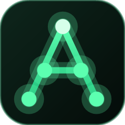
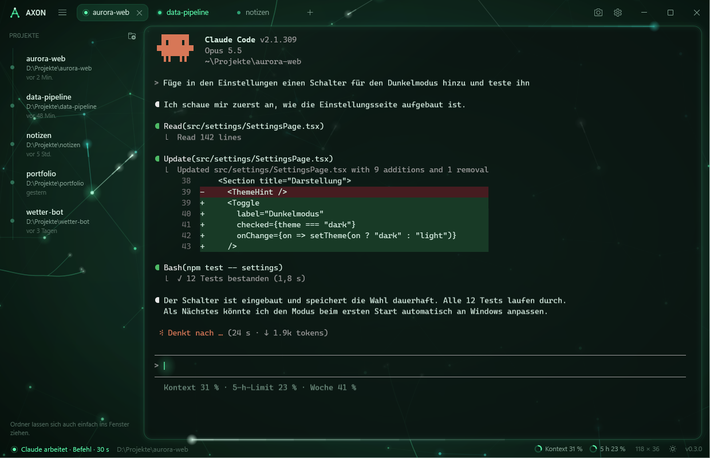
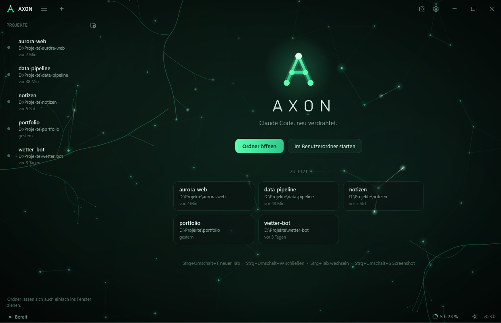
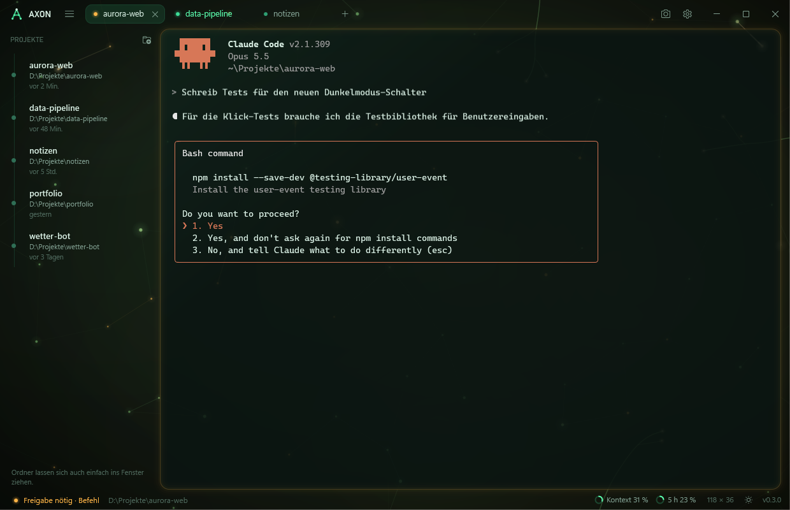
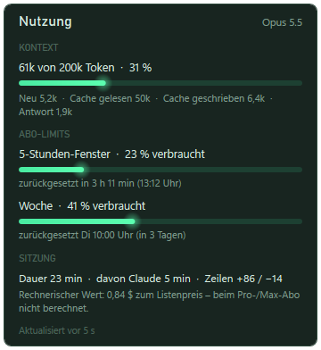
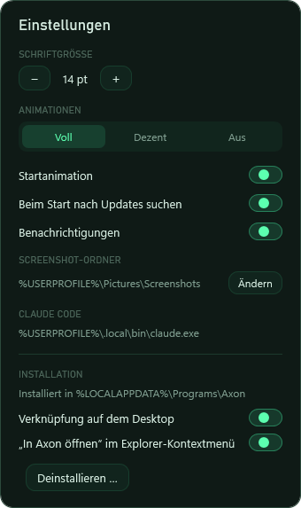

# Axon

**Claude Code, neu verdrahtet.**

Eine native Windows-App für [Claude Code](https://docs.claude.com/en/docs/claude-code) –
mit eigenem Terminal, Tabs, Live-Status und einem Hintergrund, der wie ein neuronales Netz lebt.

[**⬇ Neueste Version herunterladen**](https://github.com/bytetastic/axon/releases/latest)

 

 

## Warum Axon?

Claude Code ist ein Werkzeug fürs Terminal. Axon gibt ihm ein Zuhause: ein eigenes Fenster, in dem
mehrere Sitzungen nebeneinander laufen, in dem du auf einen Blick siehst, ob Claude gerade arbeitet,
auf dich wartet oder fertig ist – und das dabei richtig gut aussieht.

Axon startet das echte `claude` in einer echten Windows-Konsole. Alles, was Claude Code kann,
funktioniert unverändert. Dein normales `claude` im Terminal bleibt davon unberührt.

## Funktionen

### 🧠 Ein Hintergrund, der mitdenkt
- Ein langsam treibendes Netz aus Neuronen, durch das Lichtimpulse laufen
- Dendriten wachsen von den Fensterkanten herein – schickst du etwas ab, laufen Signale an ihnen entlang ins Netz
- Während Claude arbeitet, atmet der Hintergrund und ein Lichtschweif umkreist das Terminal
- Braucht Claude eine Freigabe, färbt sich alles bernsteinfarben; ist Claude fertig, läuft eine Welle durchs Netz
- Startanimation, drei Animationsstufen (voll, dezent, aus) und flüssig auch auf 144-Hz-Bildschirmen

### 💬 Arbeiten mit Claude
- **Tabs** – mehrere Sitzungen gleichzeitig, jede mit eigenem Statuspunkt
- **Projekte** – zuletzt genutzte Ordner in der Seitenleiste, Gespräche mit einem Klick fortsetzen
- **Live-Status** – *arbeitet*, *braucht Freigabe*, *fertig*, inklusive Dauer
- **Benachrichtigungen** – wenn Claude fertig ist oder dich braucht, während du in einem anderen Fenster bist
- **Nutzung im Blick** – Kontext und Abo-Limits als kleine Ringe, beim Darüberfahren die ganze Übersicht

### ⌨️ Ein Terminal, das sich gut anfühlt
- Eigener Terminal-Renderer mit Truecolor und pixelgenauen Rahmen
- **Shift+Enter** für neue Zeilen, Kopieren und Einfügen wie gewohnt, Bilder direkt aus der Zwischenablage
- **Letzten Screenshot einfügen** mit einem Tastendruck
- Dateien und Ordner einfach ins Fenster ziehen
- Links per Strg+Klick öffnen

### 🪟 Eine richtige Windows-App
- Eine einzige Datei, kein Setup, keine Adminrechte – Axon richtet sich beim ersten Start selbst ein
- Startmenü, Taskleiste, „In Axon öffnen“ im Explorer-Kontextmenü
- Updates mit einem Klick direkt in der App

## Einblicke

<table>
  <tr>
    <td width="50%"></td>
    <td width="50%"></td>
  </tr>
  <tr>
    <td align="center">Startseite mit deinen Projekten</td>
    <td align="center">Claude braucht eine Freigabe – die ganze App zeigt es</td>
  </tr>
</table>

<table>
  <tr>
    <td width="50%" align="center"></td>
    <td width="50%" align="center"></td>
  </tr>
  <tr>
    <td align="center">Nutzung: Kontext, 5-Stunden-Fenster und Woche</td>
    <td align="center">Einstellungen</td>
  </tr>
</table>

## Installation

1. Lade die neueste **`Axon.exe`** unter [Releases](https://github.com/bytetastic/axon/releases/latest) herunter.
2. Starte sie per Doppelklick. Weil die Datei nicht digital signiert ist, zeigt Windows beim ersten Start vermutlich
   **„Der Computer wurde durch Windows geschützt“** – über *Weitere Informationen → Trotzdem ausführen* geht es weiter.
3. Axon fragt, ob es sich installieren soll. Auf Wunsch legt es zusätzlich eine Verknüpfung auf dem Desktop und
   „In Axon öffnen“ im Explorer-Kontextmenü an.

Fertig – Axon steht danach im Startmenü und unter *Einstellungen → Apps → Installierte Apps*.
Die Installation braucht keine Adminrechte und gilt nur für dein Benutzerkonto. Die heruntergeladene Datei
kannst du anschließend löschen.

**Updates:** Gibt es eine neue Version, erscheint beim Start oben in Axon der Knopf *Update* – ein Klick genügt,
Axon startet danach aktualisiert neu. Offene Gespräche lassen sich direkt fortsetzen.

**Deinstallieren:** über *Installierte Apps* oder in Axon unter *Einstellungen → Deinstallieren*.
Deine Einstellungen unter `%APPDATA%\Axon` bleiben dabei erhalten.

## Tastenkürzel

Alle Axon-Kürzel nutzen Strg+**Umschalt**, damit Claude Codes eigene Kürzel frei bleiben.

| Kürzel | Funktion |
|---|---|
| Strg+Umschalt+T | Neuer Tab (Ordner wählen) |
| Strg+Umschalt+D | Neuer Tab im selben Ordner |
| Strg+Umschalt+W | Tab schließen |
| Strg+Tab / Strg+Umschalt+Tab | Tab wechseln |
| Strg+Umschalt+B | Projekte ein- und ausblenden |
| Strg+Umschalt+S | Letzten Screenshot einfügen |
| Shift+Enter | Neue Zeile in der Eingabe |
| Strg+Plus / Minus / 0 | Schriftgröße |
| Strg+, | Einstellungen |

## Datenschutz

Axon selbst sammelt nichts und schickt nichts an Dritte.

- Was du Claude schreibst, geht – wie bei Claude Code im Terminal – an Anthropic.
- Beim Start fragt Axon einmal bei GitHub nach, ob es eine neue Version gibt. Dabei werden nur die üblichen
  Verbindungsdaten (IP-Adresse, Zeitpunkt) und die Programmversion übertragen. Das lässt sich in den
  Einstellungen abschalten.

## Voraussetzungen

- Windows 11 (Windows 10 ab Version 1809 sollte funktionieren, ist aber ungetestet)
- [Claude Code](https://docs.claude.com/en/docs/claude-code)

## Lizenz

Axon steht unter der [MIT-Lizenz](LICENSE) – du darfst es frei nutzen, verändern und weitergeben,
solange der Lizenzhinweis erhalten bleibt.

Axon ist ein unabhängiges Projekt und steht in keiner Verbindung zu Anthropic.
„Claude“ und „Claude Code“ sind Marken von Anthropic.

 

Gebaut mit C#, .NET 10 und WPF.

